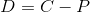
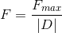
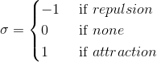
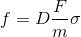

# Attraction and Repulsion Forces


[](https://github.com/kleberandrade/attraction-repulsion-force-unity/blob/master/ProjectSettings/ProjectVersion.txt)
[](https://github.com/kleberandrade/attraction-repulsion-force-unity/blob/master/LICENSE)

Unity physics example demonstrating attraction and repulsion forces, with equations and a visual demo.

## Getting started

- Clone the repository and add `.` to Unity Hub as an existing project.

- Use the recorded Editor version as the starting point. For an upgrade, work on a separate branch and preserve all `.meta` files and serialized asset references.

- Open a project scene in the Editor and enter Play mode. Available scene examples: [Assets/Scenes/SampleScene.unity](https://github.com/kleberandrade/attraction-repulsion-force-unity/blob/master/Assets/Scenes/SampleScene.unity).

## Recorded requirements

- Recorded Unity Editor: **2019.2.0f1** in [ProjectSettings/ProjectVersion.txt](https://github.com/kleberandrade/attraction-repulsion-force-unity/blob/master/ProjectSettings/ProjectVersion.txt).

## Repository map

- [Assets](https://github.com/kleberandrade/attraction-repulsion-force-unity/tree/master/Assets)
- [ProjectSettings](https://github.com/kleberandrade/attraction-repulsion-force-unity/tree/master/ProjectSettings)
- [Packages](https://github.com/kleberandrade/attraction-repulsion-force-unity/tree/master/Packages)

## Validation status

This update documents the tracked source and project metadata. It does not certify a successful build, device test or compatibility with a current toolchain. Follow any project-specific validation instructions in the original material.

## License and attribution

See [LICENSE](https://github.com/kleberandrade/attraction-repulsion-force-unity/blob/master/LICENSE) and any notices accompanying third-party code and assets. This documentation update does not change licensing or authorship.

---

## Original project material

# Attraction and Repulsion Force for Games in Unity

Example of an simple attraction and repulsion force for games

<p align="center">
  
</p>

## Methods

First, we calculate the object direction to center. Where *D* is the vector direction, *P* is the object and *C* is the center.

<p align="center">
  
</p>

Then, we calculate the force proportional to distance from object to center. Where *F* is the proportional force, *F<sub>max</sub>* is the maximum force and *D* is the distance from the object to the center.

<p align="center">
  
</p>

Finally, we calculate the vector force according to the attraction or repulsion function. Where *f* is the vector force applied to the object, *σ* is the type of (none, repulsion or attraction) and *m* is the mass of the object.

<p align="center">
  
</p>

<p align="center">
  
</p>

## Code

Basic code created from equations

```csharp
public class Force : MonoBehaviour
{
    public enum ForceType { Repulsion = -1, None = 0, Attraction = 1 }
    public ForceType m_Type;
    public Transform m_Pivot;
    public float m_Radius;
    public float m_StopRadius;
    public float m_Force;
    public LayerMask m_Layers;

    private void FixedUpdate()
    {
        Collider[] colliders = Physics.OverlapSphere(m_Pivot.position, m_Radius, m_Layers);

        float signal = (float)m_Type;

        foreach (var collider in colliders)
        {
            Rigidbody body = collider.GetComponent<Rigidbody>();
            if (body == null) 
                continue;

            Vector3 direction = m_Pivot.position - body.position;

            float distance = direction.magnitude;

            direction = direction.normalized;

            if (distance < m_StopRadius) 
                continue;

            float forceRate = (m_Force / distance);

            body.AddForce(direction * (forceRate / body.mass) * signal);
        }
    }
}
```

## License

    Copyright 2019 Kleber de Oliveira Andrade
    
    Permission is hereby granted, free of charge, to any person obtaining a copy
    of this software and associated documentation files (the "Software"), to deal
    in the Software without restriction, including without limitation the rights
    to use, copy, modify, merge, publish, distribute, sublicense, and/or sell
    copies of the Software, and to permit persons to whom the Software is
    furnished to do so, subject to the following conditions:
    
    The above copyright notice and this permission notice shall be included in all
    copies or substantial portions of the Software.
    
    THE SOFTWARE IS PROVIDED "AS IS", WITHOUT WARRANTY OF ANY KIND, EXPRESS OR
    IMPLIED, INCLUDING BUT NOT LIMITED TO THE WARRANTIES OF MERCHANTABILITY,
    FITNESS FOR A PARTICULAR PURPOSE AND NONINFRINGEMENT. IN NO EVENT SHALL THE
    AUTHORS OR COPYRIGHT HOLDERS BE LIABLE FOR ANY CLAIM, DAMAGES OR OTHER
    LIABILITY, WHETHER IN AN ACTION OF CONTRACT, TORT OR OTHERWISE, ARISING FROM,
    OUT OF OR IN CONNECTION WITH THE SOFTWARE OR THE USE OR OTHER DEALINGS IN THE
    SOFTWARE.
